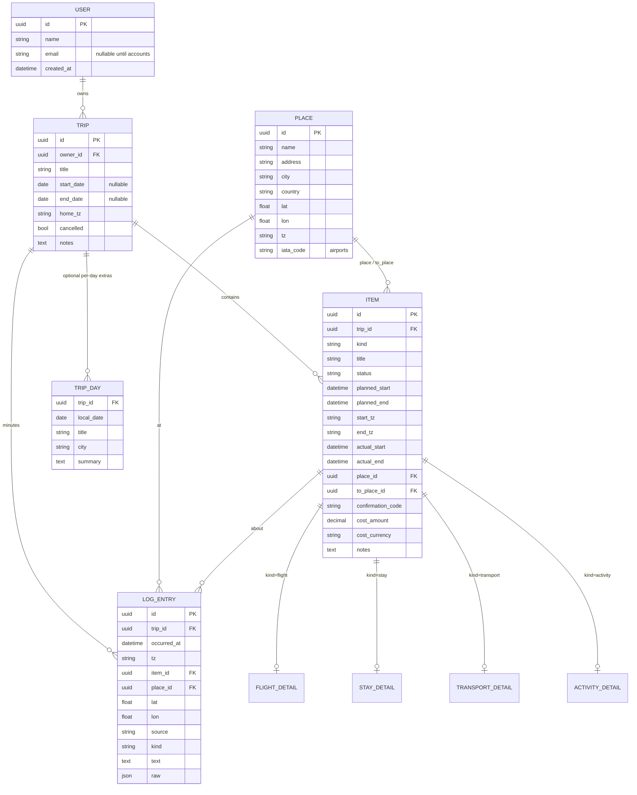

# Architecture — Trip Domain Model (F1.2)

ControlTower records past and upcoming trips and shows each one **day by day**. This document defines the data model, the rules that turn it into days, the database choices, and a first draft of the API resources. F2.1 implements it.

## Decisions at a glance
| # | Decision | Why |
|---|---|---|
| D1 | **One user now, multi-user ready.** A `user` table with a single row; every trip has an `owner_id`. | Adding accounts later is a new feature, not a data migration. Sharing gets its own tables (see *Scaling up*). |
| D2 | **Days are derived, not stored.** A trip's days come from its date range and its items' local times. A `trip_day` row exists only to hold per-day extras (title, city, summary). | A 4-night stay or an overnight flight is stored once and appears on every day it touches. Nothing to keep in sync. |
| D3 | **Plan vs actual on every item.** `planned_start/end` and optional `actual_start/end`, plus a `status`. | Delays, late check-ins, and skipped plans are real data. The agentic minutes (Phase 4) fill in the actuals. |
| D4 | **Times are stored in UTC, with an IANA zone per end.** `start_tz` / `end_tz` (e.g. `America/Los_Angeles`, `Asia/Tokyo`). | A flight leaves in one zone and lands in another. UTC sorts correctly; the zone says which local day it belongs to. |
| D5 | **Item = one common table + a detail table per kind** (SQLAlchemy joined-table inheritance). | The timeline queries one table; flight-only fields (flight number, seat) don't pollute stays, and the reverse. |
| D6 | **Places are shared rows.** Items point to a `place` (and flights/transport to a second, `to_place`). | "Hotel X" or "HND" is entered once and reused; the place carries its time zone and coordinates. |
| D7 | **Log entries are separate from items.** The minutes are timestamped observations that can *reference* an item or place. | The plan (items) and what was observed (log) have different shapes and sources. |
| D8 | **SQLite + SQLAlchemy 2.0 + Alembic.** | Zero setup, a single file, and a switch to Postgres is a URL change. Alembic versions every schema change. |
| D9 | **UUID primary keys** (stored as 32-char strings). | Safe to create offline (a future iOS app), doesn't leak counts, and merges cleanly across devices. |
| D10 | **Portable column types.** Enums are stored as strings, money as `Decimal` + ISO currency, datetimes through a UTC-enforcing type. | SQLite has no native enum, decimal, or time-zone type. These choices behave the same on Postgres. |

## Entity diagram

All tables also get `created_at` / `updated_at`. `TRIP_DAY` is unique on `(trip_id, local_date)`.

## Entities
**User:** exactly one row for now ("me"), created on first run. The `email` and auth fields stay unused until accounts arrive.

**Trip:** a titled container. `start_date` / `end_date` are optional: if unset, they're computed from the items. `home_tz` is the zone used for days with no items. Whether a trip is past, current, or upcoming is **computed** from today's date, never stored. `cancelled` is the only stored lifecycle flag.

**Item:** anything on the itinerary. Common fields:
- `kind`: `flight | stay | transport | activity | note`
- `status`: `idea | planned | booked | in_progress | done | skipped | cancelled`
- `planned_start` / `planned_end` (UTC) with `start_tz` / `end_tz`. `planned_end` is optional: a note or a single moment has none.
- `actual_start` / `actual_end` (UTC, optional). **Effective time** = actual if present, else planned. The timeline uses effective times and can show the difference ("departed 47 min late").
- `place_id` (where it happens or departs from), `to_place_id` (arrival, for flights and transport).
- Booking basics: `confirmation_code`, `cost_amount` + `cost_currency`, `notes`.

**Detail tables** (one row per item of that kind, same primary key as the item):
| Kind | Detail fields |
|---|---|
| flight | `airline` (IATA), `flight_number`, `seat`, `cabin`, `terminal_from/to`, `gate`, `aircraft`, `booking_source` |
| stay | `property_name`, `room`, `check_in_after`, `check_out_before`, `host_contact` |
| transport | `mode` (train, bus, car, ferry, taxi, walk…), `carrier`, `vehicle_ref`, `seat` |
| activity | `category` (food, sight, event, work, …), `booking_url`, `ticket_ref` |
| note | none: a note is just an item |

Flight fields are entered by hand for now. The Phase 7 flight lookup will fill the same columns.

**Place:** a reusable location with its own `tz`. Airports carry an `iata_code`. An item's `start_tz` / `end_tz` default to its places' zones, but are stored on the item so the item stays correct even if the place is edited.

**TripDay:** optional extras for one local date: a title ("Kyoto day trip"), a city, and a summary (later written by the minutes agent). Days with no extras have no row.

**LogEntry (the minutes):** a timestamped observation.
- `source`: `manual | agent | location | calendar | email | photo`
- `kind`: `check_in | arrival | departure | note | summary`
- It can reference an `item_id` ("checked in to Hotel X") and/or a `place_id`, with raw `lat` / `lon`.
- `raw` keeps the original signal (JSON) for re-processing.

Log entries never modify items directly. An agent can *propose* actual times from them in Phase 4.

## How days are derived (the timeline rule)
For a trip, the days are every local date from `start_date` to `end_date` (computed from items if unset). An item appears on each local date it touches:

- **Start day** = the date of `effective_start` in `start_tz`. **End day** = the date of `effective_end` in `end_tz` (the start day if there's no end).
- The item is listed on every date from the start day to the end day. Each listing is tagged with a **role**: `starts`, `continues`, `ends`, or `single` (starts and ends the same day).
- Within a day, listings are sorted by UTC time, with `continues` (e.g. "staying at Hotel X") pinned to the top.
- Log entries are placed on the date of `occurred_at` in their own `tz`.

Examples:
```
Stay Hotel X  check-in 6 Apr 15:00 JST, check-out 10 Apr 11:00 JST
  → 6 Apr starts · 7–9 Apr continues · 10 Apr ends

Flight UA 837  dep SFO 5 Apr 11:05 PDT  arr HND 6 Apr 15:25 JST
  → 5 Apr starts (SFO local) · 6 Apr ends (Tokyo local)
```
This is a pure function `build_timeline(trip, items, log_entries) -> list[Day]`. There's no database involved, so it's easy to unit-test.

## Database conventions (for F2.1)
- **SQLAlchemy 2.0** typed models (`Mapped[...]`, `mapped_column`), which work with mypy strict without plugins.
- **Alembic** migrations in `backend/migrations/`. Every schema change is a reviewed migration file, never `create_all` in production.
- A `UTCDateTime` `TypeDecorator`: rejects naive datetimes, converts to UTC on write, and returns aware UTC on read. SQLite would otherwise drop the zone silently.
- `ZoneInfo` validation for every `*_tz` column (it must be a real IANA name).
- DB file: `backend/data/controltower.db` (git-ignored). The URL comes from a `DATABASE_URL` setting, so Postgres later needs only a config change.
- Foreign keys: SQLite needs `PRAGMA foreign_keys=ON` per connection (set in an engine event). Deleting a trip cascades to its items, days, and log entries; places are never cascaded.

## API resources (first draft, built in Phase 2)
Framework proposal: FastAPI + Pydantic schemas, kept separate from the ORM models.
```
GET/POST           /trips                        list (filter: upcoming|current|past) / create
GET/PATCH/DELETE   /trips/{trip_id}
GET/POST           /trips/{trip_id}/items        list / create (body has kind + kind-specific details)
GET/PATCH/DELETE   /items/{item_id}
GET                /trips/{trip_id}/timeline     derived days with item listings + log entries
PUT                /trips/{trip_id}/days/{date}  set a day's title/city/summary
GET/POST           /trips/{trip_id}/log          minutes for a trip
GET/POST           /places                       search / create places
```

## Scaling up later (no reshaping needed)
| Stage | Adds | Existing data |
|---|---|---|
| Now | One `user` row; `owner_id` on trips | |
| Accounts | Auth columns on `user`, login, `owner_id` filtering on every query | Unchanged: "me" becomes the first account |
| Shared trips | `trip_member (trip_id, user_id, role: owner/editor/viewer)`; optional `item_traveller (item_id, user_id)` for per-person items (my seat, your flight) | Unchanged: the owner becomes the first member |
| Agentic minutes | Writers of `log_entry` (sources) + an agent that summarizes into `trip_day.summary` and proposes actual times | Tables already exist |
| Flight lookup | Fills `flight_detail` + places from SerpApi | Same columns as manual entry |

## Open questions (to settle in F2.1 or later)
- Attachments (booking PDFs, photos): a `file` table + storage. Deferred.
- Recurring or template trips: not planned.
- Currency conversion for trip totals: show per-currency totals first.
- Should `idea` items (wishlist, not scheduled) be allowed without times? Proposed yes: they appear in a trip's "unscheduled" list, not on a day.
