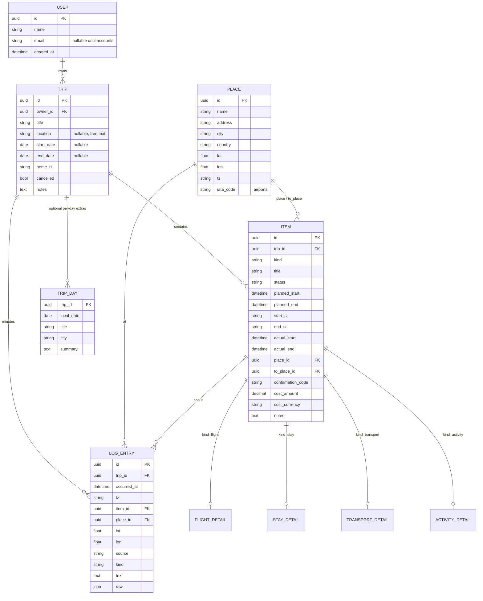
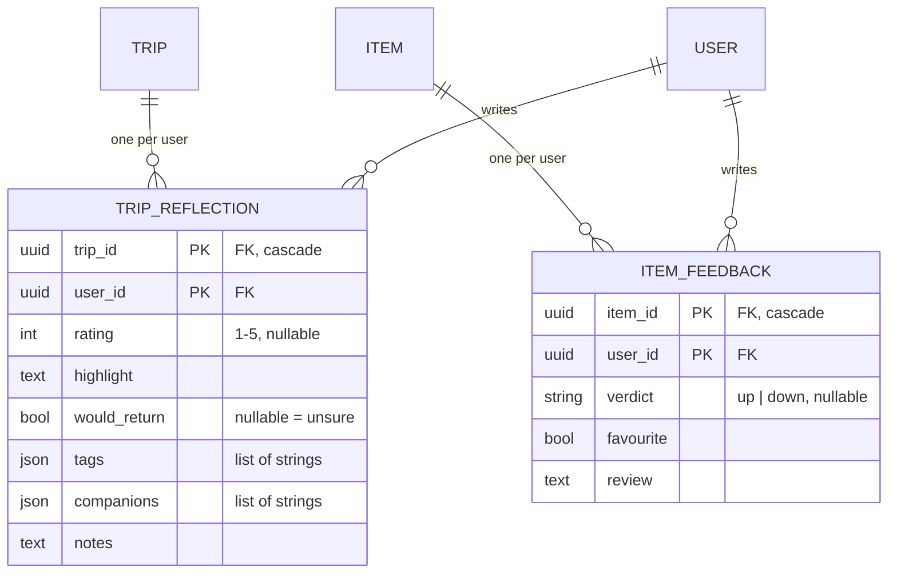

# Architecture — Trip Domain Model (F1.2; backend F2.1–F2.3; web F3.1; past-trip design F3.3)

ControlTower records past and upcoming trips and shows each one **day by day**. This document defines the data model, the rules that turn it into days, the database choices, and a first draft of the API resources. F2.1 implemented it; see *Code map* below.

## Decisions at a glance
| # | Decision | Why |
|---|---|---|
| D1 | **One user now, multi-user ready.** A `user` table with a single row; every trip has an `owner_id`. | Adding accounts later is a new feature, not a data migration. Sharing gets its own tables (see *Scaling up*). |
| D2 | **Days are derived, not stored.** A trip's days come from its date range and its items' local times. A `trip_day` row exists only to hold per-day extras (title, city, summary). | A 4-night stay or an overnight flight is stored once and appears on every day it touches. Nothing to keep in sync. |
| D3 | **Plan vs actual on every item.** `planned_start/end` and optional `actual_start/end`, plus a `status`. | Delays, late check-ins, and skipped plans are real data. The agentic minutes (Phase 4) fill in the actuals. |
| D4 | **Times are stored in UTC, with an IANA zone per end.** `start_tz` / `end_tz` (e.g. `America/Los_Angeles`, `Asia/Tokyo`). | A flight leaves in one zone and lands in another. UTC sorts correctly; the zone says which local day it belongs to. |
| D5 | **Item = one common table + a detail table per kind** (SQLAlchemy joined-table inheritance). | The timeline queries one table; flight-only fields (flight number, seat) don't pollute stays, and the reverse. |
| D6 | **Places are shared rows.** Items point to a `place` (and flights/transport to a second, `to_place`). | "Hotel X" or "HND" is entered once and reused; the place carries its time zone and coordinates. |
| D7 | **Log entries are separate from items.** The minutes are timestamped observations that can *reference* an item or place. | The plan (items) and what was observed (log) have different shapes and sources. |
| D8 | **SQLite + SQLAlchemy 2.0 + Alembic.** | Zero setup, a single file, and a switch to Postgres is a URL change. Alembic versions every schema change. |
| D9 | **UUID primary keys** (stored as 32-char strings). | Safe to create offline (a future iOS app), doesn't leak counts, and merges cleanly across devices. |
| D10 | **Portable column types.** Enums are stored as strings, money as `Decimal` + ISO currency, datetimes through a UTC-enforcing type. | SQLite has no native enum, decimal, or time-zone type. These choices behave the same on Postgres. |

## Entity diagram

All tables also get `created_at` / `updated_at`. `TRIP_DAY` is unique on `(trip_id, local_date)`.

## Entities
**User:** exactly one row for now ("me"), created on first run. The `email` and auth fields stay unused until accounts arrive.

**Trip:** a titled container. `start_date` / `end_date` are optional: if unset, they're computed from the items. `home_tz` is the zone used for days with no items. Whether a trip is past, current, or upcoming is **computed** from today's date, never stored. `cancelled` is the only stored lifecycle flag.

**Item:** anything on the itinerary. Common fields:
- `kind`: `flight | stay | transport | activity | note`
- `status`: `idea | planned | booked | in_progress | done | skipped | cancelled`
- `planned_start` / `planned_end` (UTC) with `start_tz` / `end_tz`. `planned_end` is optional: a note or a single moment has none.
- `actual_start` / `actual_end` (UTC, optional). **Effective time** = actual if present, else planned. The timeline uses effective times and can show the difference ("departed 47 min late").
- `place_id` (where it happens or departs from), `to_place_id` (arrival, for flights and transport).
- Booking basics: `confirmation_code`, `cost_amount` + `cost_currency`, `notes`.

**Detail tables** (one row per item of that kind, same primary key as the item):
| Kind | Detail fields |
|---|---|
| flight | `airline` (IATA), `flight_number`, `seat`, `cabin`, `terminal_from/to`, `gate`, `aircraft`, `booking_source` |
| stay | `property_name`, `room`, `check_in_after`, `check_out_before`, `host_contact` |
| transport | `mode` (train, bus, car, ferry, taxi, walk…), `carrier`, `vehicle_ref`, `seat` |
| activity | `category` (food, sight, event, work, …), `booking_url`, `ticket_ref` |
| note | none: a note is just an item |

Flight fields are entered by hand for now. The Phase 7 flight lookup will fill the same columns.

**Place:** a reusable location with its own `tz`. Airports carry an `iata_code`. An item's `start_tz` / `end_tz` default to its places' zones, but are stored on the item so the item stays correct even if the place is edited.

**TripDay:** optional extras for one local date: a title ("Kyoto day trip"), a city, and a summary (later written by the minutes agent). Days with no extras have no row.

**LogEntry (the minutes):** a timestamped observation.
- `source`: `manual | agent | location | calendar | email | photo`
- `kind`: `check_in | arrival | departure | note | summary`
- It can reference an `item_id` ("checked in to Hotel X") and/or a `place_id`, with raw `lat` / `lon`.
- `raw` keeps the original signal (JSON) for re-processing.

Log entries never modify items directly. An agent can *propose* actual times from them in Phase 4.

## How days are derived (the timeline rule)
For a trip, the days are every local date from `start_date` to `end_date` (computed from items if unset). An item appears on each local date it touches:

- **Start day** = the date of `effective_start` in `start_tz`. **End day** = the date of `effective_end` in `end_tz` (the start day if there's no end).
- The item is listed on every date from the start day to the end day. Each listing is tagged with a **role**: `starts`, `continues`, `ends`, or `single` (starts and ends the same day).
- Within a day, listings are sorted by UTC time, with `continues` (e.g. "staying at Hotel X") pinned to the top.
- Log entries are placed on the date of `occurred_at` in their own `tz`.

Examples:
```
Stay Hotel X  check-in 6 Apr 15:00 JST, check-out 10 Apr 11:00 JST
  → 6 Apr starts · 7–9 Apr continues · 10 Apr ends

Flight UA 837  dep SFO 5 Apr 11:05 PDT  arr HND 6 Apr 15:25 JST
  → 5 Apr starts (SFO local) · 6 Apr ends (Tokyo local)
```
Implemented in F2.3 as the pure function `build_timeline(trip) -> Timeline` (`controltower/timeline.py`), with no database involved, so it's easy to unit-test. Rules settled while building:
- **Range:** stored trip dates, else the timed items, widened to include any log entries or day extras. Every date in the range is a day, including empty ones, numbered from 1.
- **Clipping:** an item that starts before the range keeps its true role. A stay that began before the trip's stored start shows `continues` on day 1.
- **Cancelled items** are listed, with their status, but never widen the range.
- **Untimed items** (e.g. ideas) go to `unscheduled`, not onto a day.
- **Size limit:** a timeline longer than 366 days is refused (a 422), which catches typos like the wrong year.

## Database conventions (for F2.1)
- **SQLAlchemy 2.0** typed models (`Mapped[...]`, `mapped_column`), which work with mypy strict without plugins.
- **Alembic** migrations in `backend/migrations/`. Every schema change is a reviewed migration file, never `create_all` in production.
- A `UTCDateTime` `TypeDecorator`: rejects naive datetimes, converts to UTC on write, and returns aware UTC on read. SQLite would otherwise drop the zone silently.
- `ZoneInfo` validation for every `*_tz` column (it must be a real IANA name).
- DB file: `backend/data/controltower.db` (git-ignored). The URL comes from a `DATABASE_URL` setting, so Postgres later needs only a config change.
- Foreign keys: SQLite needs `PRAGMA foreign_keys=ON` per connection (set in an engine event). Deleting a trip cascades to its items, days, and log entries; places are never cascaded.

## Code map (F2.1)
| Path | What |
|---|---|
| `backend/src/controltower/models/types.py` | `UTCDateTime`, `TimeZoneName`, `Money`, `str_enum()`: the portable column types (D10) |
| `backend/src/controltower/models/base.py` | `Base` with a constraint naming convention, `UUIDPrimaryKey`, `Timestamps` |
| `backend/src/controltower/models/enums.py` | `ItemKind`, `ItemStatus`, `TransportMode`, `LogSource`, `LogKind` |
| `backend/src/controltower/models/{user,place,trip,item,log}.py` | Tables. `Item` is polymorphic-abstract; `Flight`/`Stay`/`Transport`/`Activity` join a `*_detail` table; `Note` lives in `item` only |
| `backend/src/controltower/config.py` | `database_url()`: `DATABASE_URL` or `backend/data/controltower.db` |
| `backend/src/controltower/db.py` | `make_engine()` (SQLite foreign keys on), `make_session_factory()`, `get_or_create_owner()` |
| `backend/migrations/`, `backend/alembic.ini` | Alembic (batch mode for SQLite; new migrations are auto-formatted with ruff) |
| `backend/tests/test_models.py`, `test_migrations.py` | Model behaviour; migrations == models |
| `backend/src/controltower/trips.py` | Computed trip rules: `trip_date_range()`, `trip_phase()` (upcoming/current/past/unscheduled), `item_local_days()` |
| `backend/src/controltower/api/app.py` | `create_app(session_factory=None)` + module-level `app` for uvicorn |
| `backend/src/controltower/api/deps.py` | Per-request session, owner, owner-scoped 404 lookups |
| `backend/src/controltower/api/schemas.py` | Pydantic request/response models; item shapes are discriminated unions on `kind` |
| `backend/src/controltower/api/routes/` | `trips`, `items`, `places`, `days`, `log` routers |
| `backend/tests/test_api.py`, `test_trips.py` | HTTP behaviour through `TestClient`; computed trip rules |
| `backend/src/controltower/timeline.py` | `build_timeline()`: days, roles (`single/starts/continues/ends`), log placement, unscheduled |
| `backend/src/controltower/api/routes/timeline.py` | `GET /trips/{id}/timeline`; eager-loads items (+ per-kind details), log, day extras in a fixed number of queries |
| `backend/tests/test_timeline.py`, `test_api_timeline.py` | Timeline rule unit tests; endpoint + N+1 query guard |

Built on SQLAlchemy 2.1, Alembic 1.20, FastAPI 0.159, Pydantic 2.14, uvicorn.

## API (F2.2)
FastAPI + Pydantic schemas, separate from the ORM models. Interactive docs at `/docs`. Run with `uv run uvicorn controltower.api.app:app --reload`.
```
GET/POST           /trips                        list (?phase=upcoming|current|past|unscheduled) / create
GET/PATCH/DELETE   /trips/{trip_id}              read includes computed first_day, last_day, phase
GET/POST           /trips/{trip_id}/items        list in time order / create (body: kind + that kind's fields)
GET/PATCH/DELETE   /items/{item_id}              PATCH: kind + only the fields to change
GET                /trips/{trip_id}/days         day extras that are set
PUT/DELETE         /trips/{trip_id}/days/{date}  upsert/remove a day's title/city/summary
GET/POST           /trips/{trip_id}/log          minutes, oldest first / add one
PATCH/DELETE       /log/{entry_id}               PATCH: only the fields to change (item must be on the same trip)
GET/POST           /places                       search (?q= name, city, IATA) / create
GET/PATCH/DELETE   /places/{place_id}
GET                /health
GET                /trips/{trip_id}/timeline     every local day: items (full, with role), log, day extras; + unscheduled
```
API rules:
- **Times:** any ISO 8601 offset in, always UTC out. Naive times are a 422.
- **Unknown fields** are a 422 (`extra="forbid"`), so typos aren't silently ignored.
- **Time zones are filled in for you:** `start_tz` defaults to the place's zone, else the trip's `home_tz` if the item is timed. `end_tz` defaults to `to_place`'s zone.
- **Time order:** an end before its start (planned or actual) is a 422. An unknown `place_id` or `to_place_id` is a 422.
- **Fixed kind:** an item's kind can't change, so a PATCH must send the item's own `kind`.
- **Clearing fields:** in a PATCH, `null` clears an optional field; required fields can't be nulled.
- **Money** is a JSON string (`"123.45"`), keeping it exact.
- **Ownership:** every lookup is scoped to the owner ("me"), so adding accounts later only changes how the owner is found.

## Web app (F3.1)
React + TypeScript single-page app in `web/`, served by Vite in development. The browser only talks to Vite; `/api/*` is proxied to FastAPI, so there's no CORS setup.

```
browser ──► Vite :5173 ──/api/*──► FastAPI :8000 ──► SQLite
              │
              └─ React Router: /  (TripsPage)   /trips/:tripId  (TripPage → DayCard per day)   /places  (PlacesPage)
```
- **Types from the API.** `npm run gen:api` exports the OpenAPI schema (`python -m controltower.api.openapi`) to `web/openapi.json` and generates `src/api/schema.d.ts`. `openapi-fetch` then types every path, body, and response. A backend test fails if the committed schema is stale, so the API and the UI can't drift.
- **Server state** lives in TanStack Query (`src/api/hooks.ts`). Mutations invalidate `['trips']`, which refreshes the list, the trip, and its timeline.
- **Time zones in forms.** Inputs are wall-clock times in a chosen zone. `wallTimeToUtc` converts them with `@date-fns/tz`, and a spring-forward gap moves forward. Display uses `Intl` in each item's own zone, naming the zone when it differs from the trip's.
- **Item form ↔ API** (`src/lib/itemForm.ts`):
  - A create omits blank fields, so the server's defaults and zone rules apply.
  - A PATCH sends every field, so emptied fields are cleared.
  - Fields per kind come from one `DETAIL_FIELDS` table.
- **Log and place forms** (`src/lib/logForm.ts`, `src/lib/placeForm.ts`, F3.2) follow the same pattern: pure form ↔ body functions with unit tests. A new log entry on today's card starts at the current time, else at midday; entries from the UI are `source: manual`.
- **Trip location** (F3.2) is free text ("Shinjuku, Japan", "Japan"). An LLM can read it as-is; geocoding (country code, coordinates) is left to the recommendations research (F4.3).
- **Timeline labels** (`src/lib/listing.ts`): single "11:05 – 13:00", starts "from 17:00", ends "until 11:00", continues "all day". A "planned …" note appears when the actual time differs.
- **Dialogs** use native `<dialog>`, so focus trapping and Escape need no library.
- **Demo data:** `python -m controltower.demo` adds "Japan (demo)", which exercises every kind, an overnight cross-zone flight, a multi-night stay, a delay, a log entry, and an unscheduled idea.

## Past trip record (F3.3 design; built in F3.4)
A past trip should read as a **fond record** (cover, highlight, favourite moments, the days as a journal) and also be **structured data** that can be queried and fed to the recommendations agent (F4.3). Mockup: [`docs/mockups/past-trip.html`](mockups/past-trip.html) (open it in a browser; it has a "just ended" and a "reflected" state).

### Decisions
| # | Decision | Why |
|---|---|---|
| P1 | **"Past" stays computed** (`trip_phase()`: end date before today in the trip's zone). No "close trip" button. | Same rule as D2/trip phase: nothing to keep in sync. The reflection prompt is just "phase = past and no reflection yet". |
| P2 | **Reflection and feedback are their own tables, keyed by user**: `trip_reflection (trip_id, user_id)` and `item_feedback (item_id, user_id)`. | Opinions belong to a person, not the trip. With shared trips (Phase 6), Sam and I can rate the same dinner differently, and no columns move. Today there's one row per trip/item, written by "me". |
| P3 | **Trip rating 1–5; item verdict 👍/👎 + ♥ favourite.** | A trip is rated once, so a finer scale is worth it ("trips I rated 5"). Items are many, so a fast thumbs keeps the prompt to seconds. ♥ is separate from 👍 (a favourite is a strong 👍, a highlight to resurface). |
| P4 | **`skipped` is a signal with no input.** `item.status = skipped` already exists. | You skipped the museum: that already says something. Recommendations count it with 👎, weighted lower. |
| P5 | **Tags and companions are free-text lists** (a JSON array of strings), trimmed and lower-cased for tags. | Simple to enter and enough at single-user scale (filter in Python). If tag queries get heavy, move to a `trip_tag (trip_id, tag)` table, a mechanical migration. Companions become real people in Phase 6. |
| P6 | **Stats are derived, never stored** (a pure `trip_stats(trip)` function, like `build_timeline`). | They can't go stale when an item is edited. |
| P7 | **All fields are optional, and reflecting is never required.** | A record with only a rating is still useful. The UI nudges, it doesn't block. |

### New tables

Both get `created_at` / `updated_at`. A check constraint keeps `rating` in 1–5. A feedback row with no verdict, no favourite, and no review is deleted rather than kept empty.

### Derived stats (`GET /trips/{id}/stats`)
Computed from items (cancelled ones ignored), places, and dates:
| Stat | Rule |
|---|---|
| nights | `last_day − first_day` |
| cities | distinct `trip_day.city` ∪ `place.city` of stays and activities. Flights and transport are left out, so the home airport doesn't count as a city. |
| countries | distinct `place.country` of the same places |
| flights | count of flight items not skipped |
| spend | `cost_amount` summed **per currency** (no conversion, as before). Skipped items count: you usually paid anyway. |
| season | meteorological season of the trip's middle date; flipped if most dated places have `lat < 0` (southern hemisphere) |
| feedback | counts of 👍, 👎, ♥, skipped, and items still without feedback (drives the "9 items still need…" prompt) |

### Queries it must answer
| Question | How |
|---|---|
| Favourite food spots in Japan | activity `category = food` + `favourite` + `place.country = JP` (the place's country, not the free-text trip location) |
| Trips I rated 5 in spring | `reflection.rating = 5` + derived season |
| What do I usually skip? | `status = skipped` ∪ `verdict = down`, grouped by kind / activity category |
| Would I go back to X? | `would_return` on trips whose places are in X |
| Who do I travel with most? | count of `companions` across reflections |
| **Recommendations (F4.3)** | A **taste profile**: liked / disliked / skipped categories, tags of highly rated trips, and the review text as-is for the LLM. Assembled by the backend and handed to the agent, so the agent never runs SQL. |

### API (to build in F3.4)
```
GET/PUT/DELETE   /trips/{trip_id}/reflection   my reflection (PUT replaces it; 404 if none yet)
PUT/DELETE       /items/{item_id}/feedback     my verdict / favourite / review for one item
GET              /trips/{trip_id}/stats        derived stats (above)
```
- The timeline's items gain a `feedback` field (mine, or null), so the journal view needs one request.
- Trip reads gain `reflected: bool`, so the trip list can badge past trips that are waiting for a reflection.
- Cross-trip queries (favourites, skips) start as `GET /favourites?country=&kind=&category=`. Anything wider waits for the F4.3 taste profile.

### Web (to build in F3.4)
- A past trip's page opens in **record mode**: cover → stats strip → reflection → favourite moments → days as journal (summary and log first, items compact with 👍/👎/♥). The planning view stays one toggle away.
- **Prompt:** a banner on past trips with no reflection; a "Reflect" dialog (rating, highlight, would return, tags, companions, notes). Feedback buttons work inline on each item.
- **Demo:** a second seeded trip, "Lisbon (demo)", May 2025, already past, half reflected, so both states can be reviewed.

## Scaling up later (no reshaping needed)
| Stage | Adds | Existing data |
|---|---|---|
| Now | One `user` row; `owner_id` on trips | |
| Accounts | Auth columns on `user`, login, `owner_id` filtering on every query | Unchanged: "me" becomes the first account |
| Shared trips | `trip_member (trip_id, user_id, role: owner/editor/viewer)`; optional `item_traveller (item_id, user_id)` for per-person items (my seat, your flight) | Unchanged: the owner becomes the first member |
| Agentic minutes | Writers of `log_entry` (sources) + an agent that summarizes into `trip_day.summary` and proposes actual times | Tables already exist |
| Flight lookup | Fills `flight_detail` + places from SerpApi | Same columns as manual entry |

## Open questions (to settle in F2.1 or later)
- Attachments (booking PDFs, photos): a `file` table + storage. Deferred.
- Recurring or template trips: not planned.
- Currency conversion for trip totals: show per-currency totals first.
- Should `idea` items (wishlist, not scheduled) be allowed without times? Proposed yes: they appear in a trip's "unscheduled" list, not on a day.
